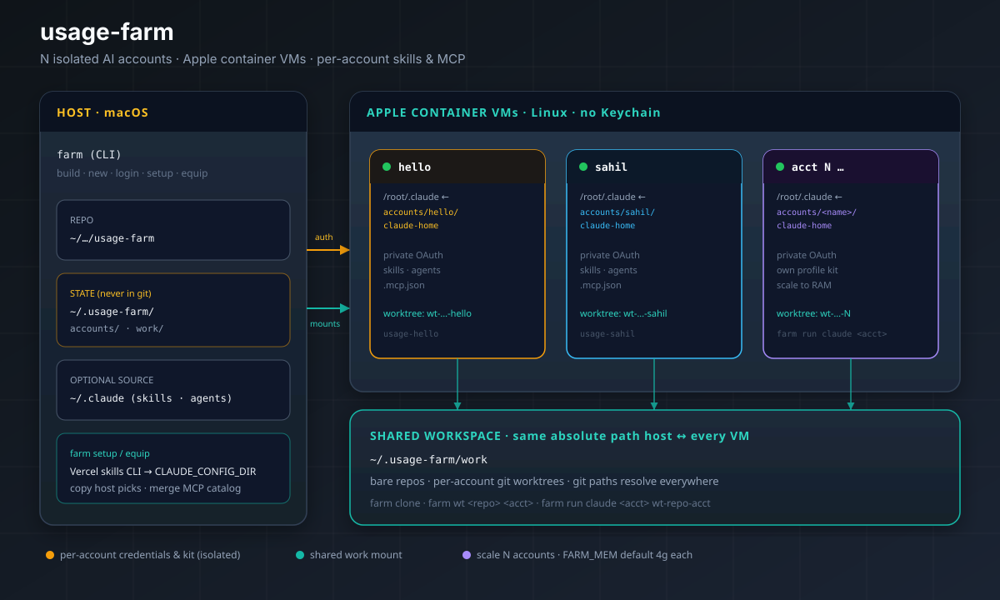

# Agent-Farm (formerly claude-farm)

**N isolated AI accounts on one Mac.**  
CLI: `farm`

Each account runs in its own Apple container VM with separate provider state:
`claude`, `codex`, `grok`, `gemini`, etc. No shared Keychain, no credential collisions.


---

## How it fits together



| Layer | What | Where |
|---|---|---|
| **CLI / tooling** | `farm` | this repo — **in git** |
| **Per-account state** | provider home directories, skills, agents, MCP, settings | `~/.usage-farm/accounts/<name>/` — **never in git** |
| **Shared workspace** | bare repos + worktrees | `~/.usage-farm/work` — mounted at the **same absolute path** on host and in every VM |

```
┌─ Host (macOS) ─────────────────────────────────────────────┐
│  farm  ·  farm setup  ·  farm equip                        │
│  ~/.usage-farm/accounts/<acct>/claude-home  ──┐             │
│  ~/.usage-farm/accounts/<acct>/codex-home   ──┤             │
│  ~/.usage-farm/work  ──────────────────────┐  │             │
└─────────────────────────────────────────────│──│─────────────┘
                                              │  │
         ┌────────────────────────────────────┘  │
         ▼                                       ▼
   shared work/                         /root/.claude
   (identical path)                    per-account provider homes
         ▲
   ┌─────┴──────┬──────────────┬──────────────┐
   │  VM hello  │  VM sahil    │  VM acct N   │
   │  own OAuth │  own OAuth   │  own OAuth   │
   └────────────┴──────────────┴──────────────┘
```

Isolation is structural: each VM has no macOS Keychain, so credentials stay in per-account files on the host volume.

---

## Requirements

- macOS 26+ on Apple Silicon, with Apple's [`container`](https://github.com/apple/container) CLI
- `jq` and `python3` on the host
- Node.js on the host — only for `farm setup` / `farm equip` (the Vercel skills CLI runs via `npx`)
- `fzf` (optional) — nicer multi-select in `farm setup`

---

## Install

```bash
# one-time image
./farm.sh build
# for extra provider clients, build once with:
# docker build -t usage-agent --build-arg EXTRA_AI_CLIENTS="<npm-packages>" .

# shell aliases (defines `farm` + per-account shortcuts)
echo 'source /path/to/usage-farm/farm-aliases.sh' >> ~/.zshrc
```

Aliases from `farm-aliases.sh`:

| Alias | Runs |
|---|---|
| `farm` | main CLI |
| `usage-farm` | synonym for `farm` |
| `claude-farm` | legacy synonym for `farm` |
| `usage-<acct>` | `farm run claude <acct>` — generated automatically for every existing account |
| `claude-<acct>` | legacy compatibility alias |

---

## Quick start

```bash
farm build                          # one-time image
farm new hello sahil                # any names, any count
farm login hello claude             # /login for Claude
farm login hello codex              # open your codex auth flow in that VM
farm setup hello                    # skills + MCP wizard (Claude-specific tooling)
farm clone git@github.com:you/repo.git
farm wt repo hello                  # worktree + branch for that account
farm run claude hello wt-repo-hello  # run provider in that worktree
farm run codex hello wt-repo-hello   # same container, different provider
farm run gemini hello wt-repo-hello  # run another client in same VM
```

## Migration from `claude-farm`

- `~/.usage-farm` is used by default; if it does not exist and `~/.claude-farm` exists, the legacy path is used automatically.
- Legacy container naming (`claude-<acct>`) is still supported for existing accounts.
- Legacy aliases (`claude-farm`, `claude-<acct>`) remain as compatibility shims.

---

## Multi-provider commands

- `farm run <provider> <acct> [dir]` — run any client inside the account container
- `farm claude|codex|grok|gemini <acct> [dir]` — convenience aliases for common clients
- `farm login <acct> [provider]` — open client for first-time auth
- For any other provider, keep directory naming as `<acct>/<provider>-home` and command name as `<provider>` to keep mounting and launch behavior predictable.

Container startup mounts these default provider homes:

- `~/.usage-farm/accounts/<acct>/claude-home` -> `/root/.claude`
- `~/.usage-farm/accounts/<acct>/codex-home` -> `/root/.codex`
- `~/.usage-farm/accounts/<acct>/grok-home` -> `/root/.grok`
- `~/.usage-farm/accounts/<acct>/gemini-home` -> `/root/.gemini`

If your provider client needs extra install steps or different auth paths, set `FARM_IMAGE` to a custom image and install it there.
If you use a custom image, keep the container binary command available in `$PATH` (example: `codex`, `grok`, `gemini`) and mount its home as `<acct>/<provider>-home`.

## Adding a custom provider

- Add a client binary to the container image (for example via npm or apt), then rebuild:
  - `docker build -t usage-agent --build-arg EXTRA_AI_CLIENTS="<packages>" .`
  - If the provider is not npm-based, install it in a custom `Dockerfile` and set `FARM_IMAGE` to that rebuilt tag (for example, `export FARM_IMAGE=my-usage-image`).
- Launch with `farm run <provider> <acct> [dir]` where `<provider>` matches the executable name.
- Store credentials and config in `~/.usage-farm/accounts/<acct>/<provider>-home` (automatically mounted at `/root/.<provider>` by default).
- Verify:
  - `farm login <acct> <provider>` opens the auth flow for first setup.
  - `./farm.sh up <acct> && ./farm.sh run <provider> <acct>` should execute the CLI inside the VM.
- Optional per-account alias patterns:
  - Existing helper aliases are `usage-<acct>` / `claude-<acct>`; create custom aliases manually in your shell as needed.

---

## Skills, MCP, and profiles

Containers start with a **blank Claude home** by default (no host plugins/hooks). Equip them deliberately:

```bash
farm setup hello                      # interactive wizard (Claude-centric)
farm equip hello --profile coding     # non-interactive
farm equip hello --list               # inventory
farm profiles                         # bundled profiles + MCP catalog
```

### `farm setup` flow

1. **Baseline profile** — `blank` · `minimal` · `coding` · `frontend` · `custom`
2. **Vercel skills CLI** — installs with  
   `CLAUDE_CONFIG_DIR=~/.usage-farm/accounts/<acct>/claude-home`  
   so packages land on the mounted volume and appear inside the container
3. **Host picks** — multi-select (fzf) of skills / agents / commands from `~/.claude` — **copied**, not symlinked
4. **MCP catalog** — container-safe servers only (`context7`, `playwright`, `filesystem`)

| Bundled profile | Intent |
|---|---|
| `minimal` | `find-skills` only |
| `coding` | `vercel-labs/agent-skills` + common host toolkit + context7 |
| `frontend` | UI-oriented skills + playwright |

Profiles: `profiles/*.json`  
MCP entries: `mcp-catalog/*.json`  
Applied stamp: `~/.usage-farm/accounts/<acct>/profile.json`

```
farm setup / equip
        │
        ├─► npx skills add …   (CLAUDE_CONFIG_DIR = account home)
        ├─► copy host skills / agents / commands
        └─► merge mcp-catalog → account .mcp.json
                    │
                    ▼
     ~/.usage-farm/accounts/<acct>/claude-home/
         skills/  agents/  commands/  .mcp.json  profile.json
                    │
                    ▼  (bind-mounted)
              /root/.claude inside the VM
```

---

## Commands

```
farm build                     build/rebuild the usage-agent image
farm new <acct>...             create + start account container(s)
farm login <acct> [provider]   interactive auth for provider
farm up [acct...]              start all (or named) account containers
farm down [acct...]            stop all (or named)
farm ls                        accounts, running state, auth, email
farm rename <old> <new>        rename account (auth preserved)
farm clone <url> [name]        bare-clone into shared work/
farm wt <repo> <acct> [br]     per-account worktree
farm run <provider> <acct> [dir]  run provider CLI
farm claude <acct> [dir]       run claude in that container
farm codex <acct> [dir]        run codex in that container
farm grok <acct> [dir]         run grok in that container
farm gemini <acct> [dir]       run gemini in that container
farm shell <acct>              bash inside the container
farm rm <acct>...              delete container (state kept)

farm setup <acct>              interactive skills / MCP wizard
farm equip <acct> --profile X  apply profile non-interactively
farm equip <acct> --list       show installed kit
farm profiles [list|show <name>] bundled profiles + MCP catalog
```

Env overrides: `FARM_STATE` · `FARM_IMAGE` · `FARM_MEM` (default `4g`) · `FARM_CPUS` (default `4`) · `HOST_CLAUDE`

---

## Scaling to N

Nothing is hardcoded to a fixed account count:

```bash
farm new acct5 acct6 review-bot
```

Practical ceiling is RAM. Each container is a VM capped at `FARM_MEM` (default 4g, allocated on demand). Rule of thumb:

**comfortable N ≈ free RAM ÷ 3–4 GB** for actively working agents.

Idle containers cost little CPU. Stop what you are not using: `farm down acct3`.

---

## Notes

- **Auth survives rebuilds** — it lives on the host under `~/.usage-farm/accounts/<name>/` in provider homes. Back it up carefully; it holds tokens.
- **GitHub from a container:** `farm shell <acct>` → `gh auth login`, and set `git config --global user.email` per account.
- **Image contents:** Node 22, `git`, `gh`, `rg`, `jq`, and `@anthropic-ai/claude-code` by default. Add other clients by building with `--build-arg EXTRA_AI_CLIENTS`.
- **Agent separation** inside the shared farm is by convention (one worktree per account). For hard isolation, mount a per-account work dir instead of the shared `work/`.

---

## Layout (git vs state)

| Path | Purpose | In git? |
|---|---|---|
| `farm.sh` · `lib/equip.sh` | CLI | yes |
| `profiles/` · `mcp-catalog/` | equip defaults | yes |
| `docs/architecture.svg` · `docs/hero.jpg` | diagrams | yes |
| `farm-aliases.sh` | shell aliases | yes |
| `~/.usage-farm/accounts/*` | credentials + kit | **no** |
| `~/.usage-farm/work/` | shared workspace | **no** |

---

## License

[MIT](LICENSE)
